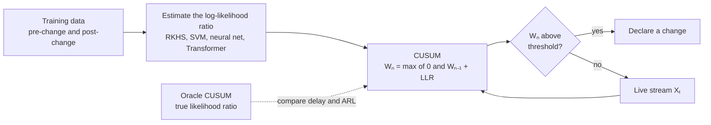

<div align="center">

# ML-based Sequential Change Detection

**Detect the moment a data stream changes, quickly and without false alarms, when nobody can tell you the distributions: learn the likelihood ratio from data and plug it into CUSUM.**

[How it works](#how-it-works) &nbsp;·&nbsp; [Notebooks](#the-notebooks) &nbsp;·&nbsp; [Run it](#run-it)


</div>

## How it works, in one page

- **The problem:** a stream X₁, X₂, … follows a distribution P₀ until an unknown time T, then switches to P₁. Declare the change as soon as possible after T, while keeping false alarms rare when there is no change.
- **The classical answer:** CUSUM, which adds up log-likelihood ratios and stops when the sum crosses a threshold, is optimal, but only if it knows the exact likelihood ratio between P₀ and P₁. In practice neither distribution is known.
- **What this does:** it learns the likelihood ratio from pre-change and post-change training data (by convex risk minimization, following Nguyen, Wainwright and Jordan), using RKHS, SVM, neural-network and Transformer estimators, and studies how much detection power each keeps compared with the oracle CUSUM. A second, classifier-based approach builds a sequential test by betting (an e-process) for multi-class change detection.

> [!NOTE]
> **Research from the University of Michigan Machine Learning Lab,** with Shubhanshu Shekhar. The notebooks are the record of the experiments; the figures in `results/` are their saved outputs.

---

## How it works



The threshold is set for a target average run length (ARL) under no change, and each estimator is judged by its detection delay (τ − T)⁺ at that false-alarm level.

## The notebooks

| Notebook | Question |
|---|---|
| `1-OracleCUSUM` | CUSUM with the true likelihood ratio, as the baseline |
| `2-DelayVsEffectSize` | Detection delay vs. effect size, against theory |
| `3-ARLforOracle` | Stopping times with no change: does the ARL constraint hold? |
| `4-LLR_Misspec` | Which likelihood-ratio misspecifications are benign, and which are costly |
| `5-EstimatingLLR-RKHS` | Learning the likelihood ratio in an RKHS by convex risk minimization |
| `6-EstLLR+CUSUM` | CUSUM driven by the learned likelihood ratio |
| `7-RKHSvsOracle`, `8-SVMvsRKHSvsOracle`, `9-NNvsSVMvsRKHS` | Estimator comparisons against the oracle |
| `10-ExploringTransformer`, `11-TransformerComparisions` | Transformer-based likelihood-ratio estimators, including under shift |
| `A1-StdVsModifiedCUSUM` | Standard vs. modified CUSUM statistics |

**Classifier-based betting approach** (`BettingApproach/`): data sources (one-hot categorical, Gaussian mixtures, MNIST), an e-process `SequentialHypothesisTest` with a configurable grid, smoothing and false-alarm rate, and a change detector built on it. See [BettingApproach/doc.md](BettingApproach/doc.md).

## Run it

**Prerequisites:** Python 3 and Jupyter. PyTorch is needed for the Transformer notebooks and for MNIST in the betting approach.

```bash
git clone https://github.com/juyal-devashish/SequentialChangeDetection.git && cd SequentialChangeDetection
python -m venv .venv && source .venv/bin/activate
pip install -r requirements.txt jupyter
jupyter lab notebooks/
```

The betting approach runs from `BettingApproach/` (`run_experiments.sh`).

## Repository layout

```
notebooks/          numbered experiments, from the oracle CUSUM to learned estimators and Transformers
BettingApproach/    classifier-based sequential test by betting and change detector
results/            saved figures from the notebooks
scripts/            helper scripts
```

## References

- Xie, L., et al. (2021). [Sequential (Quickest) Change Detection: Classical Results and New Directions](https://arxiv.org/abs/2104.04186).
- Nguyen, X., Wainwright, M., Jordan, M. (2010). [Estimating divergence functionals and the likelihood ratio by convex risk minimization](https://arxiv.org/abs/0809.0853).
- Granjon, P. (2013). *The CUSUM algorithm: a small review*.

## License

[MIT](LICENSE)
